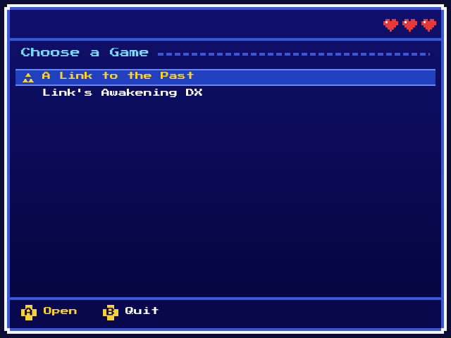
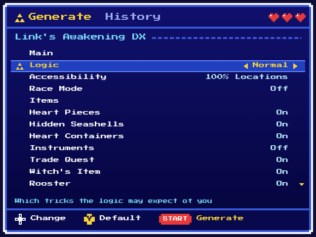

# Zelda Randomizer on Miyoo

A seed generator for two Zelda randomizers that runs on the **Miyoo Mini
Flip** (OnionOS), with no PC and no network:

- *A Link to the Past Randomizer*: every alttpr.com setting; the generator
  is a C port of VT, checked against VT itself.
- *Link's Awakening DX Randomizer*: LADXR's settings (a few greyed, not
  supported yet); the generator is a C port of LADXR, checked against
  LADXR itself.

Pick a game, pick your settings with the d-pad, press Start, and play the
new seed from Onion's SNES or GBC list.

<table>
  <tr>
    <td></td>
    <td></td>
  </tr>
  <tr>
    <td></td>
    <td></td>
  </tr>
  <tr>
    <td></td>
    <td></td>
  </tr>
</table>

## Install

You need a Miyoo Mini Flip on Onion `v4.5-dev` or later, and your own ROM
of each game you want to play. No Nintendo ROM is in this repository.

| Game | ROM you need | Copy it to |
| --- | --- | --- |
| *A Link to the Past* | headerless Japanese 1.0, 1,048,576 bytes, MD5 `03a63945398191337e896e5771f77173` (the game you play is in English) | `App/ZeldaRando/alttp/base.sfc` |
| *Link's Awakening DX* | English 1.0 (`.gbc`), 1,048,576 bytes, SHA-1 `d90ac17e9bf17b6c61624ad9f05447bdb5efc01a` | `App/ZeldaRando/ladx/base.gbc` |

1. Download `ZeldaRando.zip` from the
   [latest release](https://github.com/Canadadry/alttp-randomizer-handled-linux/releases/latest).
2. Unzip `ZeldaRando.zip` at the root of the SD card.
3. Copy each ROM you have to its path above. One game is enough: the other
   one says its ROM is missing when you open it.
4. In Onion's Package Manager ("VERIFIED" tab), install the SNES list
   (`Emu/SFC`) for *A Link to the Past* and the GBC list (`Emu/GBC`) for
   *Link's Awakening DX*, if they are not installed yet.
5. Start **Zelda Randomizer** from Onion's Apps list.

An `App/ALttPR/` folder left by an older release can be deleted.

## Use

- **Choose a Game**: at launch, A opens the game under the cursor (the one
  you opened last time); B in a game comes back here, B here quits.
- **Generate**: Up / Down picks a setting, Left / Right changes it, Start
  generates. In *Link's Awakening DX*, L2 / R2 jump between the setting
  groups. A greyed value says why it cannot be used. *A Link to the Past*
  seeds land in Onion's SNES list and *Link's Awakening DX* seeds in its
  GBC list, each in a folder `ZeldaRando` (`Roms/SFC/ZeldaRando/`,
  `Roms/GBC/ZeldaRando/`); each seed keeps its own save.
- **History** (L1 / R1): lists the game's seeds; A shows a seed's settings
  and spoiler, X deletes the seed with its save and states.

If something goes wrong the screen says what to do, and
`App/ZeldaRando/zrando.log` says why; include it when you report a problem.

## Development

```bash
make test
```

```bash
make check
```

To run the app on a PC (needs `libsdl1.2-dev`, `libsdl-ttf2.0-dev`,
`libsdl-image1.2-dev`):

```bash
make sdl-pc
```

```bash
tests/alttp/build/sdl/zrando --sd tmp/sd --theme themes/alttp
```

`make package` builds the release zip `tests/alttp/build/package/ZeldaRando.zip`
(needs docker). Everything else (cross build, themes, screenshots) is in
[`CLAUDE.md`](CLAUDE.md) and `make help`.
