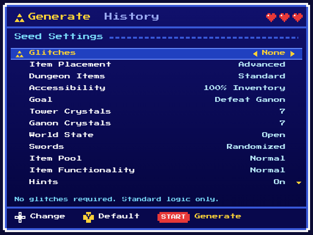
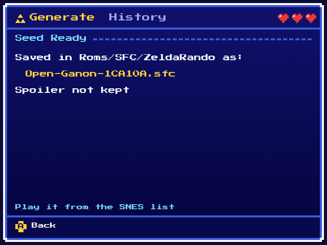
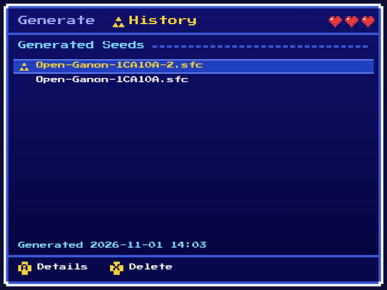
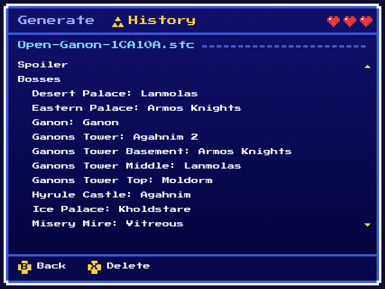

# Zelda Randomizer on Miyoo

An *A Link to the Past Randomizer* seed generator that runs on the **Miyoo
Mini Flip** (OnionOS). Pick your settings with the d-pad, press Start, and
play the new seed from Onion's SNES list. Every alttpr.com setting is there;
the generator is a C port of VT, checked against VT itself.

<table>
  <tr>
    <td></td>
    <td></td>
  </tr>
  <tr>
    <td></td>
    <td></td>
  </tr>
</table>

## Install

You need a Miyoo Mini Flip on Onion `v4.5-dev` or later, and your own
headerless Japanese 1.0 ROM (1,048,576 bytes, MD5
`03a63945398191337e896e5771f77173`). The game you play is in English. No
Nintendo ROM is in this repository.

1. Download `ZeldaRando.zip` from the
   [latest release](https://github.com/Canadadry/alttp-randomizer-handled-linux/releases/latest).
2. Unzip `ZeldaRando.zip` at the root of the SD card.
3. Copy your ROM to `App/ZeldaRando/alttp/base.sfc`.
4. Start **Zelda Randomizer** from Onion's Apps list.

An `App/ALttPR/` folder left by an older release can be deleted.

## Use

- **Generate**: Up / Down picks a setting, Left / Right changes it, Start
  generates. The ROM lands in Onion's SNES list, folder `ZeldaRando`; each seed
  keeps its own save.
- **History** (L1 / R1): lists your seeds; A shows a seed's settings and
  spoiler, X deletes the seed with its save and states.

If something goes wrong the screen says what to do, and
`App/ZeldaRando/zrando.log` says why; include it when you report a problem.

## Development

```bash
make test
```

```bash
make check
```

To run the app on a PC (needs `libsdl1.2-dev`, `libsdl-ttf2.0-dev`,
`libsdl-image1.2-dev`):

```bash
make sdl-pc
```

```bash
tests/alttp/build/sdl/zrando --sd tmp/sd --theme themes/alttp
```

`make package` builds the release zip `tests/alttp/build/package/ZeldaRando.zip`
(needs docker). Everything else (cross build, themes, screenshots) is in
[`CLAUDE.md`](CLAUDE.md) and `make help`.
